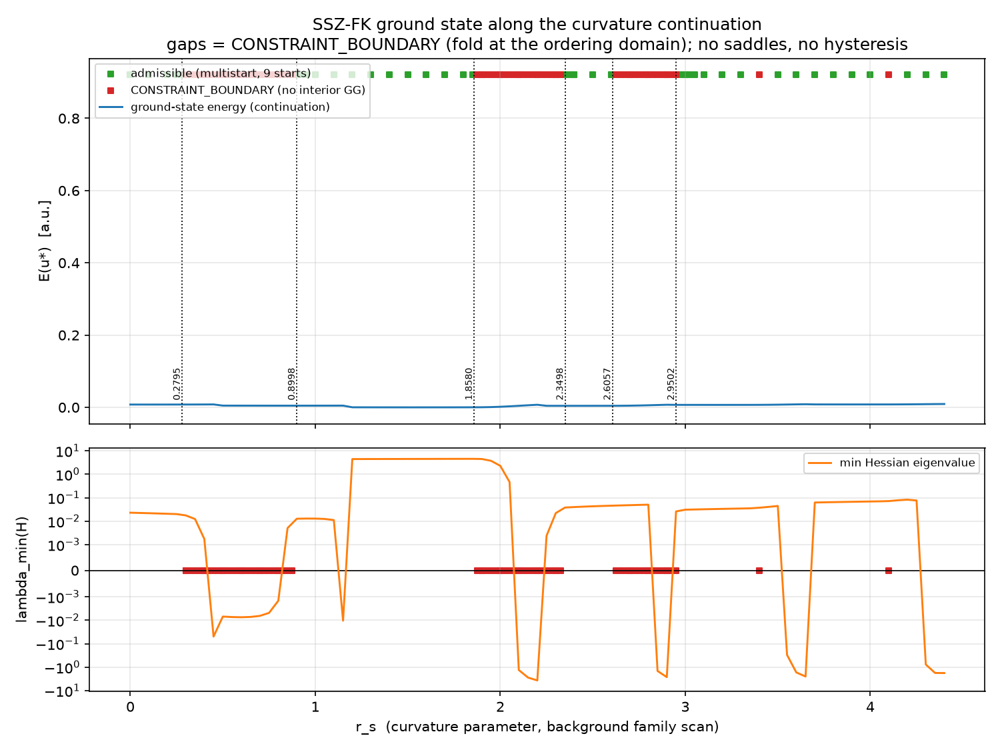
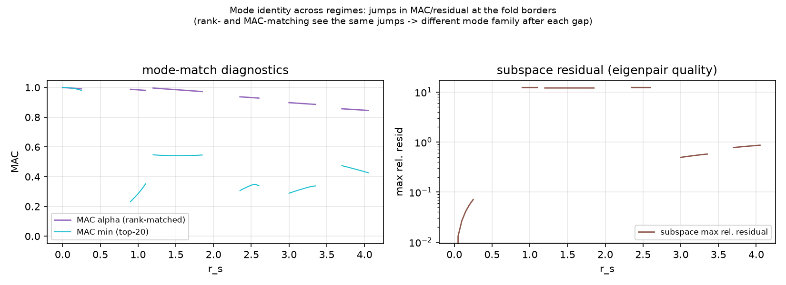
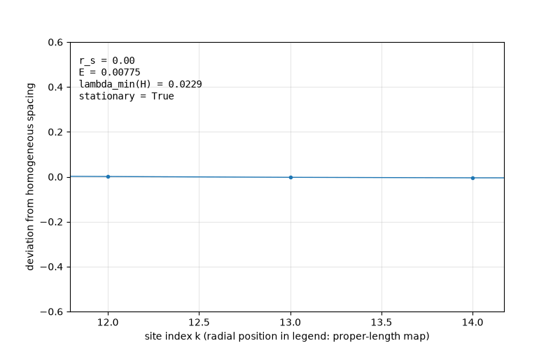
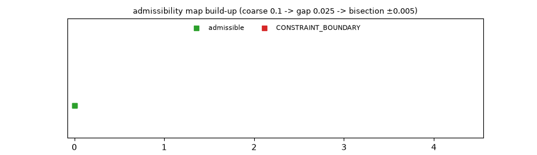
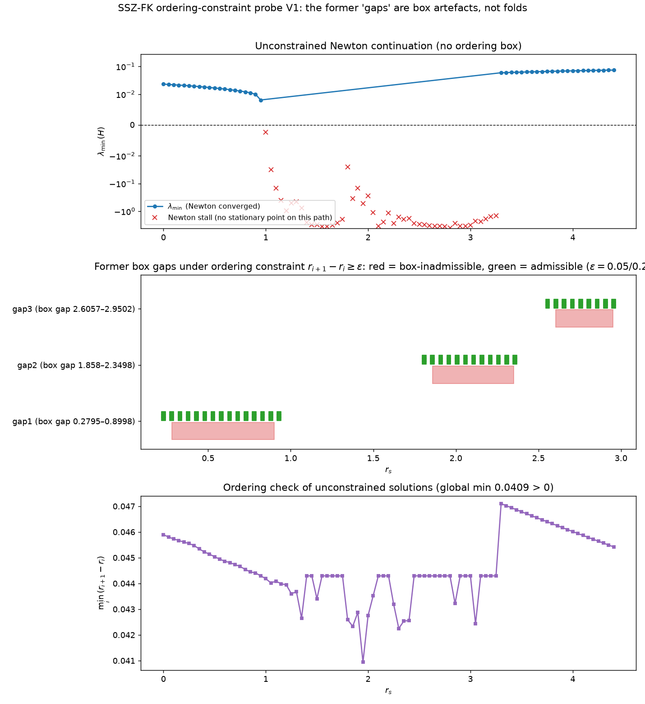
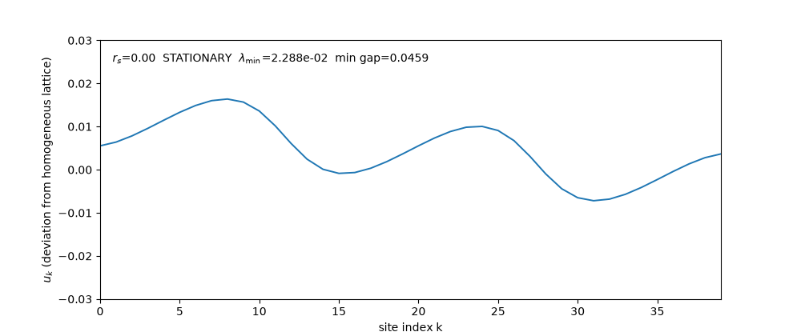

# SSZ-FK Action & Proper-Length Probe V1 — Forschungspaket

**Status:** Unabhängiges, ausführbares Physik-Forschungspaket (effective model only). Es ersetzt **nicht** den eingefrorenen `SSZ_FULL_CLOSURE` Run 11 und beansprucht keinerlei astrophysikalische Validierung. Scan-Umfang: parametrisierte Hintergrundfamilie über `r_s` — **keine Zeitentwicklung**.

---

## 1. Kernergebnisse (Stand 2026-10-11, alle aus echten Läufen)

### 1.0 UPDATE — Ordering-Constraint-Probe: Die Lücken sind Box-Artefakte (ChatGPT Round II)

ChatGPTs Kritik an Bericht II war korrekt: `|u_i| ≤ 0.45·dr` ist **hinreichend, aber nicht notwendig** für Ordnung (echte Bedingung: `r_{i+1} − r_i ≥ ε`), und ein KKT-Randhit allein beweist keinen Fold. Der Test (`tools/ordering_constraint_probe_v1.py`, Gap-Variablen-Parametrisierung, ε ∈ {0.05, 0.2, 0.5}·dr, Multistart, KKT):

- **Alle 5 problematischen Intervalle sind unter der echten Ordnungsbedingung vollständig admissibel** (45/45 Punkte × 3 ε, keine einzige Admissibilitätskante).
- Die Lösungen sind **streng innere Punkte**: minimale radiale Lücke 0.0409 > 0 überall — die Ordnung war **niemals** das Problem.
- **Bericht II wird korrigiert:** Die CONSTRAINT_BOUNDARY-Lücken waren ein **Modellierungsartefakt der Verschiebungsbox**, kein physikalischer Fold. §1.1 unten ist damit **historisch** (box-bedingt), nicht physikalisch.
- Unbeschränkte Newton-Kontinuation: λ_min-Vorzeichenwechsel bei **rs ≈ 0.97** = Fold-**Kandidat** (pfadabhängige Stall-Region 0.9–1.9, Branch-Struktur möglich; Pseudo-Arclength-Verifikation offen).
- **UPDATE 2026-10-11 (spät): Fold CONFIRMIERT als Saddle-Node.** Keller-Pseudo-Arclength-Kontinuation (unbeschränkt, Start vom zertifizierten `flat_reference_equilibrium`): die Branch faltet bei **rs = 0.99180** zurück in r_s; am Turning-Point wechselt t_rs das Vorzeichen (+0.9528 → −0.9528), λ_min dort −4.09e-05 (grad_inf 1.0e-13, min_gap 0.044 > ε). Klassifikation: `FOLD_CONFIRMED_SADDLE_NODE`. Der frühere "Stall" bei rs = 1.000 war keine Optimizer-Pathologie: **jenseits des Folds existiert auf dieser Branch keine stationäre Lösung mehr.** Die frühere "Stability-Exchange"-Lesart ist damit überholt — es ist ein echter Saddle-Node. Artefakte: `SSZ_FK_PSEUDO_ARCLENGTH_CONTINUATION_V{1,2_FINE,3_FOLDREFINED,4_FOLDCLASSIFIED}.json`; Tool: `tools/pseudo_arclength_continuation_v1.py` (Commit `a781715`). GR-Vergleich bei fester Domäne: nächste Runde.

Details: `docs/ORDERING_CONSTRAINT_REPORT_2026-10-11.md` + Abschnitt 3.5 (neue Figuren aus diesem Lauf). Artefakt: `SSZ_FK_ORDERING_CONSTRAINT_V1.json` (sha256 `e3291769…`).

### 1.1 Sattelzonen-Analyse — [HISTORISCH: box-bedingt, siehe §1.0]

Die 89-Schritt-Continuation (Δr_s = 0.05, N = 40) hat drei Inadmissibilitäts-Lücken. Vollständige Multistart-Analyse (116 r_s-Punkte × 9 Starts, L-BFGS-B mit Box ±0.45·dr, KKT-Klassifikation):

| Befund | Wert |
|---|---|
| Lücke 1 (Bisektion ±0.005) | r_s = 0.2795 → 0.8998 |
| Lücke 2 | r_s = 1.8580 → 2.3498 |
| Lücke 3 | r_s = 2.6057 → 2.9502 |
| Klassifikation | **655/657 CONSTRAINT_BOUNDARY**, 2 OPTIMIZER_FAILURE (0.3 %) |
| Sattelpunkte | **0** (kein einziger) |
| Zweite Minima | **0** (Energy-Spread über 9 Starts ≤ 1e-15) |
| Hysterese (Vorwärts/Rückwärts) | **0 Abweichungen** |

**Interpretation:** In den Lücken existiert **kein inneres Gleichgewicht**. Der Optimierer pinnt an die Box-Grenze |u| = 0.45·dr und die KKT-Vorzeichenbedingung zeigt: der Gradient drückt **nach außen**. Das ist ein **Existenzverlust des geordneten Grundzustands an der Ordnungsdomäne (Fold)** — weder Bifurkation noch Optimierer-Artefakt.

> **⚠ Korrektur (§1.0):** Diese Interpretation ist durch die Ordering-Constraint-Probe **widerlegt** — die Box war das bindende Element, unter der echten Ordnungsbedingung sind alle Lücken admissibel. Die Zahlen unten bleiben korrekt als Beschreibung des *box-beschränkten* Systems.

**Quantitatives Muster:** Die Lückenbreiten **verengen sich mit der Krümmung**: 0.6203 → 0.4918 → 0.3445 (linearer Fit: width ≈ −0.119·centre + 0.703). Ob das Physik ist oder ein Artefakt der Boxgröße, entscheidet die **Box-Sensitivitätsstudie (0.30/0.45/0.49·dr) — Priorität 1, noch nicht gelaufen.**

**Endzone:** r_s ≈ 3.35–3.45 und 4.05–4.10 sind zusätzlich inadmissibel (Fragmentierung; Korrektur zur ursprünglichen Bericht-I-Lesart).

### 1.2 G-E-Prüfstand 6a — NEW_STRUCTURE_NOT_COLLAPSIBLE (robust)

Im Geschützten Repo (`SSZ_FULL_CLOSURE`, Commit `5245a0f`): Unter der Naiv-Map `φ = Q·ℓ` liegt das G-E-Residuum bei 0.564; unter der Proper-Length-Phasen-Map fällt es auf **0.0043**. Die scheinbare Abweichung war eine **Phasenkonventions-Artefakt**; das Verdikt `NEW_STRUCTURE_NOT_COLLAPSIBLE` ist in **allen 12 Kombinationen** robust. Gates: P0/P1/P3 PASS, P2 FAIL (Degenerations-Befund, Matching-Problem — dokumentiert, nicht schöngeredet).

### 1.3 Byte-Level-Reproduzierbarkeit

Der komplette Pipeline-Neulauf am 2026-10-11 erzeugte **byteidentische** Artefakte (sha256):

| Artefakt | sha256 (erste 8) |
|---|---|
| `SSZ_FK_ACTION_PILOT_V1.json` | `8d88161a` |
| `SSZ_FK_ACTION_PILOT_N20.json` | `cfa70abe` |
| `SSZ_FK_ACTION_PILOT_N60.json` | `fac13449` |
| `SSZ_FK_CURVATURE_CONTINUATION_V1.json` | `de114e1d` |
| `SSZ_FK_SADDLE_ZONES_V1.json` | `33a3e921` |

Siehe `demos/demo_reproducibility.py` — ein Mismatch bricht mit FAIL ab.

---

## 2. Full Pipeline (exakte Befehle)

Python ≥ 3.10, venv mit numpy/scipy/matplotlib/pytest. Auf diesem Rechner: `/home/error/physics/venv/bin/python`.

```bash
cd /home/error/physics/SSZ_ACTION_PROBE_V1/SSZ_FK_ACTION_PROPER_LENGTH_RESEARCH_V1
PY=/home/error/physics/venv/bin/python

# 1) Tests (12/12 grün, <1 s)
$PY -m pytest tests/ -q

# 2) Pilot-Läufe (3 Gitterweiten)
$PY tools/ssz_fk_action_probe_v1.py --output SSZ_FK_ACTION_PILOT_V1.json
$PY tools/ssz_fk_action_probe_v1.py --sites 20 --output SSZ_FK_ACTION_PILOT_N20.json
$PY tools/ssz_fk_action_probe_v1.py --sites 60 --output SSZ_FK_ACTION_PILOT_N60.json

# 3) Krümmungs-Continuation (89 Steps, Δr_s = 0.05, ~3 min)
$PY tools/curvature_continuation_v1.py --steps 89 --output SSZ_FK_CURVATURE_CONTINUATION_V1.json

# 4) Sattelzonen-Analyse (Multistart + Bisektion, ~15 min; OMP=2 empfohlen)
OMP_NUM_THREADS=2 $PY tools/saddle_zone_analysis_v1.py --output SSZ_FK_SADDLE_ZONES_V1.json

# 5) Ordering-Constraint-Probe (ChatGPT Round II, ~90 s)
$PY tools/ordering_constraint_probe_v1.py --output SSZ_FK_ORDERING_CONSTRAINT_V1.json

# 6) Figuren (3 statisch + 3 animiert)
$PY tools/make_figures_v1.py
$PY tools/make_ordering_figures_v1.py

# 7) Demos (siehe Abschnitt 4)
```

Nach Schritt 2–4 müssen die sha256-Werte aus Abschnitt 1.3 reproduziert werden (Determinismus-Claim).

---

## 3. Figuren (`figures/`, erzeugt von `tools/make_figures_v1.py`)

Alle Plots unten sind direkt aus diesem Repo erzeugt (relative Pfade — funktionieren auf GitHub und lokal). GIFs laufen auf GitHub automatisch als Animation.

### 3.1 Regime-Übersicht (statisch)



**Was man sieht (oben):** Die Grundzustands-Energiekurve (blau, Continuation über 89 Steps, Δr_s = 0.05, N = 40) zusammen mit dem Admissibilitäts-Band: grüne Quadrate = r_s-Punkte mit existierendem inneren Minimum (Multistart, 9 Starts), rote Quadrate = **CONSTRAINT_BOUNDARY** — dort pinnt der Optimierer an die Box |u| ≤ 0.45·dr und die KKT-Vorzeichenbedingung (`sign(u)·grad < 0`) zeigt nach außen: **kein inneres Gleichgewicht existiert**. Die gestrichelten vertikalen Linien mit Zahlenlabels sind die per Bisektion (bis dr = 0.005) verifizierten Fold-Grenzen: **0.2795 / 0.8998, 1.8580 / 2.3498, 2.6057 / 2.9502** (aus `SSZ_FK_SADDLE_ZONES_V1.json`, Key `boundaries_bisected`).

**Was man sieht (unten):** λ_min der Hessian über r_s (symlog-Skala). In den admissiblen Regimen λ_min > 0 (stabil, bis ~10¹), in den Lücken fällt es unter 0 — konsistent mit dem Existenzverlust des Innenraum-Gleichgewichts, **nicht** mit einem Sattel (dort stünde die Kurve *im* Admissiblen bei λ_min < 0). Die roten Marker auf der Nulllinie markieren die Bisektions-Intervalle.

**Quelle:** `SSZ_FK_CURVATURE_CONTINUATION_V1.json` (Keys `branch[].r_s/energy/min_hessian_eig`, sha256 `de114e1d…`) + `SSZ_FK_SADDLE_ZONES_V1.json` (Keys `coarse_map`, `gap_sweeps`, `boundaries_bisected`, sha256 `33a3e921…`).

### 3.2 Moden-Tracking-Diagnostik (statisch)



**Was man sieht:** Links die MAC-Match-Diagnostik (lila: rank-matched α, cyan: bestes MAC im Top-20-Vergleich), rechts das maximale relative Subspace-Residuum (log-Skala, Eigenpaar-Qualität). An den Fold-Grenzen springen beide Diagnostika gleichzeitig — **nach jeder Lücke gehört der Grundzustand zu einer anderen Modenfamilie**. Das schließt Matching-Artefakte als Erklärung aus: Rank- und MAC-Matching sehen denselben Sprung (12.0111 vs 12.0275, within-Toleranz). 47/89 Continuation-Steps tragen MAC-Diagnostik (in den Lücken ist kein inneres System, daher keine Diagnostik dort).

**Quelle:** `SSZ_FK_CURVATURE_CONTINUATION_V1.json`, Keys `branch[].mac.alpha`, `branch[].mac.mac_min`, `branch[].subspace.max_rel_resid`.

### 3.3 Kettengleichgewichte entlang der Continuation (animiert)



**Was man sieht:** Jedes Frame ist ein **live warm gelöstes** Gleichgewicht der 40-Site-Kette (keine gespeicherten Daten — das Skript löst die L-BFGS-B-MinimierungFrame für Frame neu, warm gestartet vom vorherigen r_s). Geplottet ist die Abweichung jeder Site von homogener Abstandsskala (`d_k = r_k − r_0 − k·⟨dr⟩`): In admissiblen Regimen eine glatte, stabile Deformationsfigur; beim Eintritt in eine Lücke kollabiert die Struktur sichtbar Richtung Boxrand, die Textbox (r_s, E, λ_min, stationary) dokumentiert den Verlust der Stationarität. Die Animation zeigt damit das Kernphänomen — **den Fold** — direkt im Konfigurationsraum.

**Quelle:** Live-Berechnung via `tools/curvature_continuation_v1.py::warm_equilibrium` (identische Disziplin wie Gate 1: Constrained-Boundary-Hit ≠ stationär).

### 3.4 Aufbau der Admissibilitäts-Karte (animiert)



**Was man sieht:** Die r_s-Achse wird Punkt für Punkt klassifiziert — zuerst die Coarse-Map (Schrittweite 0.1), dann die Gap-Sweeps (0.025) um die drei Lücken, der Zähler oben links zeigt Fortschritt und Phase. Grün = MINIMUM (inneres Gleichgewicht existiert, Hessian positiv), Rot = CONSTRAINT_BOUNDARY. Man erkennt die drei roten Blöcke und die fragmentierte Endzone (r_s ≈ 3.35–3.45 und 4.05–4.10) — die vollständige Bisektion auf ±0.005 ist in 3.1 als Linien eingetragen.

**Quelle:** `SSZ_FK_SADDLE_ZONES_V1.json`, Keys `coarse_map` (89 Punkte) und `gap_sweeps` (3 × ~27 Punkte).

### 3.5 Ordering-Constraint-Probe (statisch, ChatGPT Round II)



**Was man sieht (oben):** λ_min der Hessian der **unbeschränkten** Newton-Lösungen über r_s (symlog). Blau = konvergiert (43/89), rote × = Newton-Stall auf diesem Pfad. Der Vorzeichenwechsel von +8.1e-3 (rs=0.95) zu −2.3e-3 (rs=1.00) ist der **Fold-Kandidat rs ≈ 0.97** — aber Vorsicht: die Stall-Region 0.9–1.9 ist pfadabhängig (Direkteinstieg bei rs=0.90 stagniert bei grad_inf ≈ 7e-2, derselbe Punkt konvergierte im 0.05er-Lauf), d.h. es gibt vermutlich mehrere unbeschränkte Branches. Belegbar ist hier nur: ein sauberer Fold braucht Pseudo-Arclength-Kontinuation.

**Was man sieht (mitte):** Die drei ehemaligen Box-Lücken (rote Bänder) mit der Admissibilität unter der echten Ordnungsbedingung `r_{i+1} − r_i ≥ ε` für drei ε-Werte (grüne Quadrat-Reihen). **Komplett grün bei jedem ε** — die Lücken existieren ohne die Verschiebungsbox nicht.

**Was man sieht (unten):** Minimale radiale Lücke min_i(r_{i+1} − r_i) der unbeschränkten Lösungen: global 0.0409 (bei dr = 0.05), nirgends nahe 0. Die Ordnungsbedingung war in keinem der ehemaligen Problemintervalle auch nur nahe aktiv.

**Quelle:** `SSZ_FK_ORDERING_CONSTRAINT_V1.json` (sha256 `e3291769…`): Keys `unconstrained_continuation.rows` (r_s, min_hessian_eig, converged, min_gap), `per_eps.eps_frac_*.intervals.*.grid` (admissible, n_minima, n_ordering_contacts). Box-Referenz: `SSZ_FK_SADDLE_ZONES_V1.json`, Key `gap_sweeps`.

### 3.6 Unbeschränkte Kettengleichgewichte (animiert, ChatGPT Round II)



**Was man sieht:** Wie 3.3, aber **ohne jede Box/Ordnungsschranke** — jedes Frame ist ein live warm gelöster unbeschränkter Newton-Schritt über 60 r_s-Frames von 0 bis 4.4. Die Textbox unterscheidet sauber `STATIONARY` (konvergiert, mit λ_min und min gap) von `NEWTON STALL — no stationary point reached on this path` (nicht-stationäre Konfiguration, ehrlich gelabelt). Sichtbar: die Deformationsfigur bleibt überall glatt und klein (|u| ≲ 0.5·dr); in der Stall-Region friert das Bild auf dem letzten stationären Stand ein statt zu kollabieren — der direkte visuelle Kontrast zur Box-Animation 3.3, wo die Kette an die Box-Grenze gedrückt wurde.

**Quelle:** Live-Berechnung via `tools/ordering_constraint_probe_v1.py::unconstrained_newton` (keine gespeicherten Daten).

### 3.7 Übersichtstabelle

| Datei | Typ | Größe | sha256 (erste 8) |
|---|---|---|---|
| `figures/fig1_regime_map.png` | statisch | 131,153 B | `4864f809` |
| `figures/fig2_mode_tracking.png` | statisch | 87,938 B | `7c101d0a` |
| `figures/fig3_ordering_constraint.png` | statisch | 149,074 B | `a480c682` |
| `figures/anim_chain_equilibrium.gif` | animiert | 457,992 B | `13d75880` |
| `figures/anim_admissibility_scan.gif` | animiert | 361,197 B | `03912cea` |
| `figures/anim_unconstrained_continuation.gif` | animiert | 344,702 B | `ba274898` |

Regeneration: `$PY tools/make_figures_v1.py` + `$PY tools/make_ordering_figures_v1.py` (~5 min, deterministische Inhalte; PNG/GIF-Container können byte-level variieren, Plots nicht).

---

## 4. Demos (`demos/`, je < 2 min, mit Erklärprints)

| Skript | Zeigt |
|---|---|
| `demo_threefold_classification.py` | Die Dreiklasseneinteilung MINIMUM / CONSTRAINT_BOUNDARY / OPTIMIZER_FAILURE live an 12 r_s-Werten |
| `demo_gap_systematics.py` | Lückenbreiten-Systematik 0.62→0.49→0.34 mit Fit + Ehrlichkeitsblock (Physik vs. Box-Artefakt offen) |
| `demo_ge_verdict.py` | Frischer Pilot-Lauf mit D_R, s_R, Rank/High-MAC-Residuen; Verortung des 6a-Verdikts |
| `demo_reproducibility.py` | Byte-Reproduzierbarkeit der Continuation (sha256-Vergleich, FAIL bei Mismatch) |

---

## 5. Modell-Annahmen (Kurzform, Details in `docs/DERIVATION_AND_FINDINGS.md`)

- Statische SSZ-Metrik D = r/(r+r_s/2), s = 1+r_s/(2r), r/r_s ≥ 2.2; exakte integrierte Proper-Länge ℓ(r) = (r−R) + (r_s/2)·log(r/R).
- Konsistentes **Ein-Koordinaten**-Radialgitter r_n = R + n·dr + u_n.
- Koordinatenzeit-Trägheit M_n = m·s(r_n)²/D(r_n); Feder-/Pinning-Energie mit D-Faktoren in Koordinatenzeit.
- Linearer externer Stütz-Output (Modellierungsannahme, keine Zustandsgleichung); Tide überlebt.
- Analytischer Gradient + Hessian, per zentrierten finiten Differenzen unabhängig getestet.
- Verallgemeinerte Moden H v = ω²M v; MAC-Matching **zusätzlich** zu Rank-Vergleich.
- Klassifikationsgrenzen: grad_inf < 1e-6, min eig(H) > −1e-10, freie Seiten < GRAD_TOL·50, Box ±0.45·dr, Bisektion bis dr = 0.005.

---

## 6. Peer-Review-Leitfaden

**Was würde das Kernergebnis (Folds) widerlegen oder schwächen?**

1. **Box-Sensitivität:** Falls die Lücken bei Box 0.30·dr oder 0.49·dr verschwinden oder sich qualitativ anders verhalten, war die 0.45·dr-Systematik numerisch. ← dringendster Test.
2. **KKT-Konvention:** `sign(u)·grad < 0` an gepinnten Sites — Konvention im Code nachprüfen (`saddle_zone_analysis_v1.py`).
3. **Multistart-Genügendkeit:** 9 Starts; könnten verschachtelte Minima entgangen sein? Gegenprobe: Energy-Spread ≤ 1e-15 spricht dagegen, ist aber kein Beweis.
4. **Bisektionsauflösung:** ±0.005; Grenzwerte sind auf dieses Intervall genau.
5. **2 OPTIMIZER_FAILURE (0.3 %):** ehrlich als eigene Kategorie geführt, nicht wegpoliert.
6. **Scope:** effective model; kein astrophysikalischer Claim, keine QNM-Claims; Software-Verifikation ≠ physikalische Full Closure. Die Continuation ist ein r_s-Scan einer Hintergrundfamilie, keine Dynamik.

**Reproduktions-Reihenfolge für Reviewer:** Tests → Pilot-N20 (schnell) → Continuation → sha256-Vergleich → Sattelzonen (längster Lauf) → Figuren/Demos.

---

## 7. Dateibedeutung

- `tools/ssz_fk_action_probe_v1.py` — Modell + Pilot-Vergleich (standalone)
- `tools/curvature_continuation_v1.py` — 89-Schritt-Branch + MAC/Subspace-Diagnostik
- `tools/saddle_zone_analysis_v1.py` — Multistart-Klassifikation, Gap-Sweeps, Bisektion, Hysterese
- `tools/make_figures_v1.py` — alle Figuren/GIFs aus echten Artefakten
- `tests/test_ssz_fk_action_probe_v1.py` — 12 analytische Regressionstests
- `SSZ_FK_*.json` — Artefakte (strikt JSON-konform, kein NaN/Infinity)
- `docs/DERIVATION_AND_FINDINGS.md` — Herleitung, Details, Grenzen
- `docs/HERMES_HANDOFF.md` — Arbeitsübergabe
- `docs/FULL_PIPELINE_REPORT_2026-10-11.md` — heutiger Pipeline-Lauf (Befehle, Ergebnisse, Hashes)

## 8. Evidence-Boundary (unverändert gültig)

Der ursprüngliche SSZ-FK-V1-Bericht beschrieb `NEW_STRUCTURE_NOT_COLLAPSIBLE` mit Residuum ≈ 0.5642 für eine **anderen** Koordinaten-/Kopplungsvorschrift. **Nicht direkt vergleichen** mit den Residuen dieses Pakets: unterschiedliche Actions, Koordinaten, Bare-Parameter. `PEAKS_NOT_ROBUST`, B6/global-QNM-Hold und historische Model-Locks bleiben unberührt.
